<h1 align="center">slide-studio</h1>

<p align="center">
  <strong>Slides de equity research em nível de competição, com qualquer empresa e qualquer slide mestre.</strong><br>
  Plugin do Claude Code: pesquisa o tema, escreve o roteiro e entrega o .pptx editável, validado no PowerPoint.
</p>

<p align="center">
  
  
  
</p>

<p align="center">
  <a href="#instalação">Instalação</a> ·
  <a href="#como-funciona">Como funciona</a> ·
  <a href="#galeria">Galeria</a> ·
  <a href="#uso">Uso</a> ·
  <a href="#estrutura">Estrutura</a>
</p>

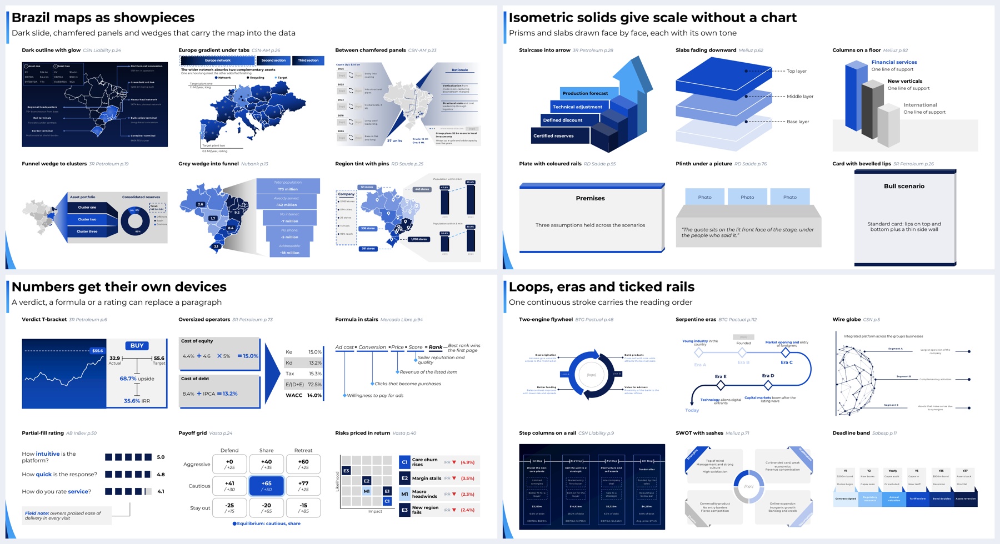

<p align="center"><sub>Amostras geradas pelo plugin, em formas editáveis. O conteúdo é fictício; só a técnica vem dos decks de referência.</sub></p>

## Por que usar

Slide feito por IA costuma sair com o número certo e o visual genérico. O slide-studio separa os dois trabalhos e dá ao designer um repertório real:

- **Receita, não colagem:** 9 passos tirados dos melhores decks, do argumento à conferência do peso visual. Veja [`RECEITA.md`](skills/ppt-designer/references/RECEITA.md).
- **Pesquisa com crítico:** um subagente procura os vãos da pesquisa, e outro julga se o roteiro dá um bom slide.
- **Verificador automático:** barra colisão de texto, excesso de palavras e dados, slide plano e gráficos que o dono já reprovou.
- **Catálogo de 22 decks de competição:** 987 slides por propósito e por visual, e 590 técnicas garimpadas em 1.633 páginas.
- **274 itens do catálogo com peça pronta:** mapas, sólidos, feixes, fitas, diagramas e elementos.
- **Qualquer mestre:** lê grade, cores e zonas proibidas do seu .pptx. As peças assumem as cores do tema.
- **Tudo editável:** gráficos nativos e formas do PowerPoint, sem imagem colada para simular volume.
- **Sem prova inventada:** peças de evidência ficam como moldes até você trazer foto, print ou entrevista real.

## Como funciona

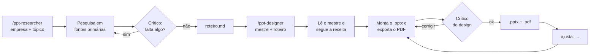

| Skill | O que faz | Entrega |
|---|---|---|
| `/ppt-researcher <empresa> "<tópico>"` | Pesquisa o tópico em fontes primárias, com um crítico de vãos, e escreve um argumento encadeado e um banco de provas, revisados por um crítico de roteiro | `research.md` + `roteiro.md` |
| `/ppt-designer <mestre.pptx> <roteiro.md>` | Lê o mestre, segue a receita, escolhe as provas, monta o slide e valida no PDF do PowerPoint, com verificador automático e crítico de design | `.pptx` + `.pdf` |

## Galeria

Amostras em tamanho pequeno. As técnicas vieram de decks de competição, e cada peça indica o deck e a página de origem.

### Mapas

Estados de 9 países e países em 1:50m, desenhados como formas editáveis.

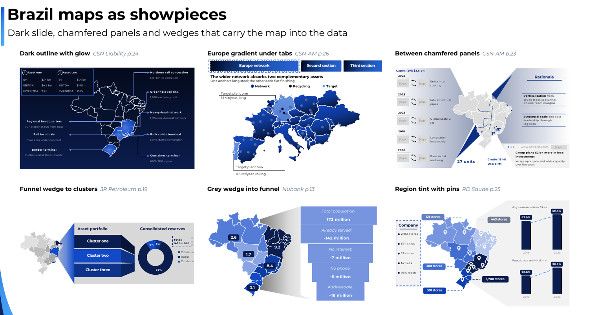

<details>
<summary>Mais mapas</summary>

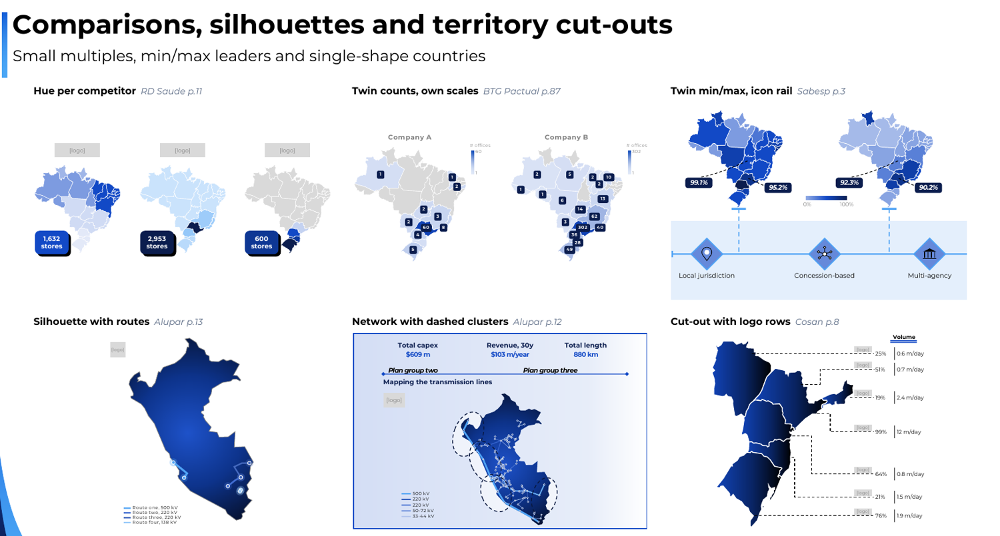

</details>

### Profundidade

Volume em volta do dado, com os gráficos planos por padrão.

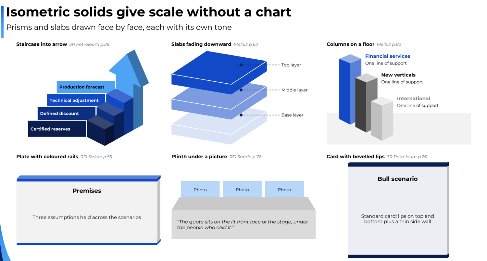

| Feixes | Fitas e dobras | Camadas |
|---|---|---|
| 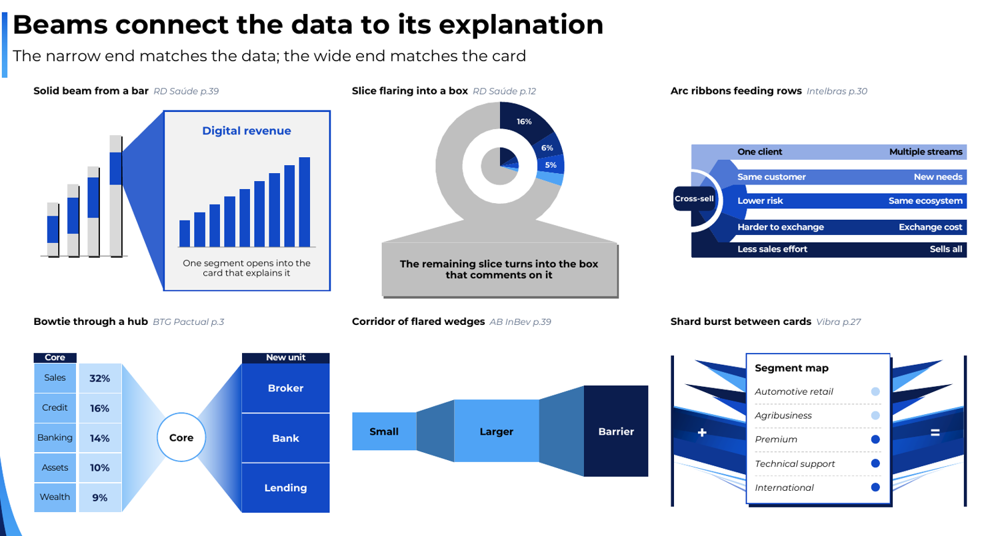 | 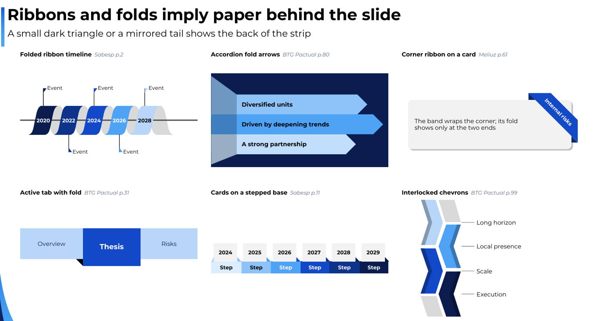 | 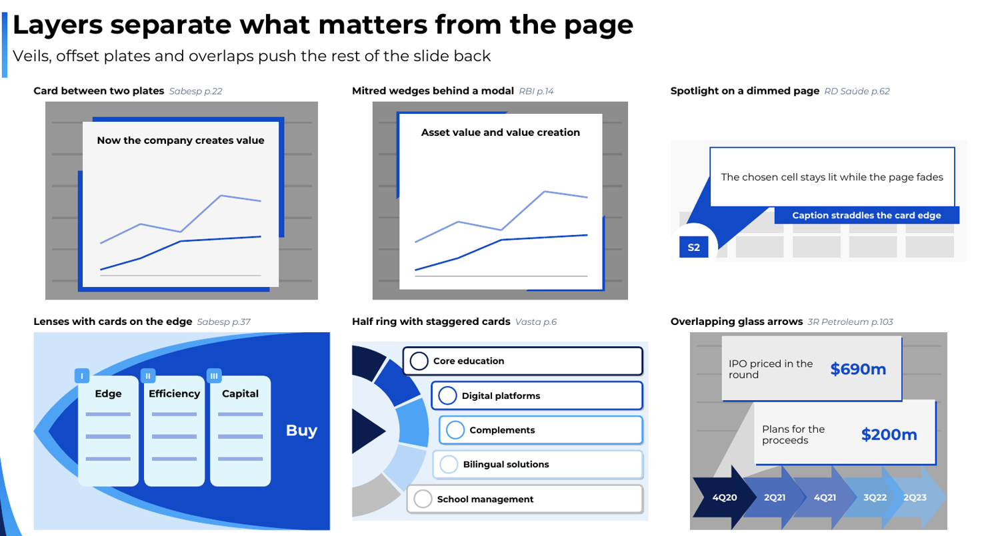 |

### Dados e anotações

| Dispositivos de dado | Anotações |
|---|---|
| 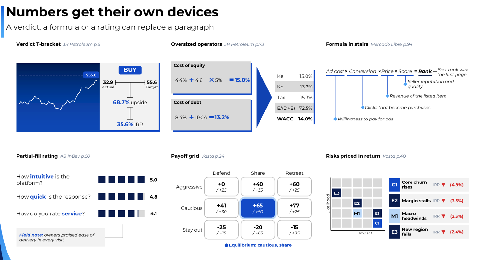 | 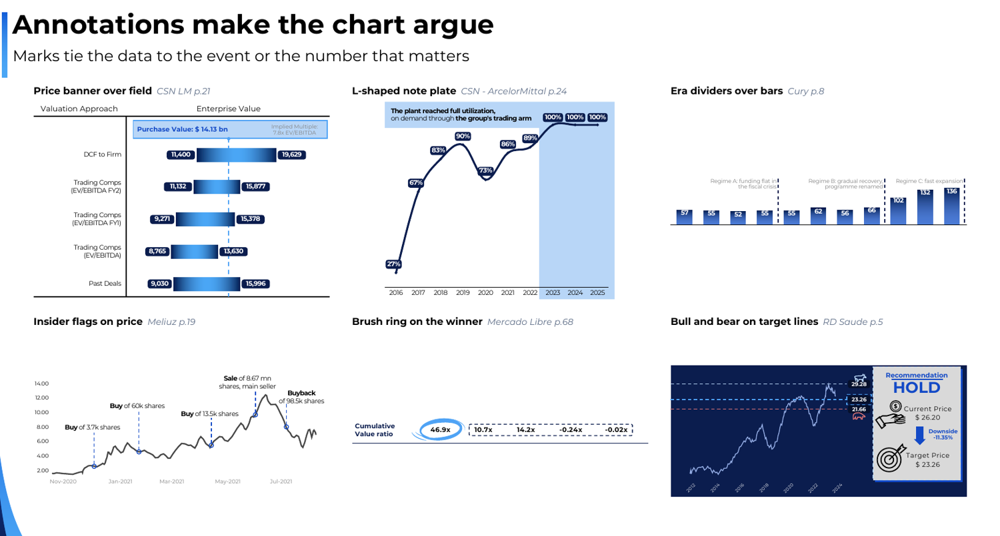 |

### Diagramas e navegação

| Diagramas | Navegação |
|---|---|
| 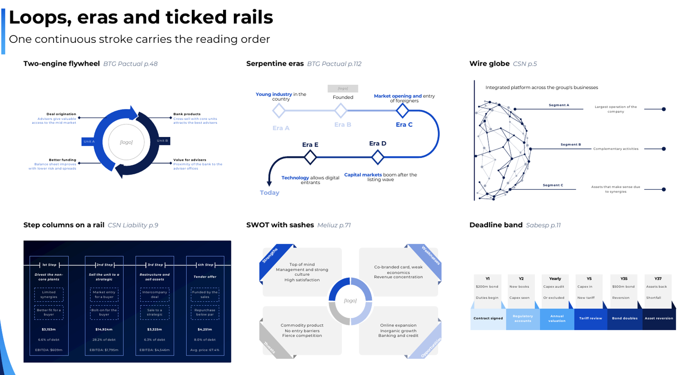 | 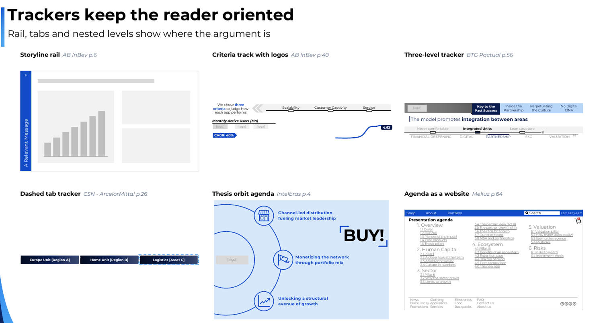 |

### Moldes para evidência real

Entrevista, teste de campo e código são peças fortes, mas não podem ser inventados. O molde reserva o layout com rótulos como `[print]` e `[quote from a real interview]`, e não vai para a entrega sem o material real.

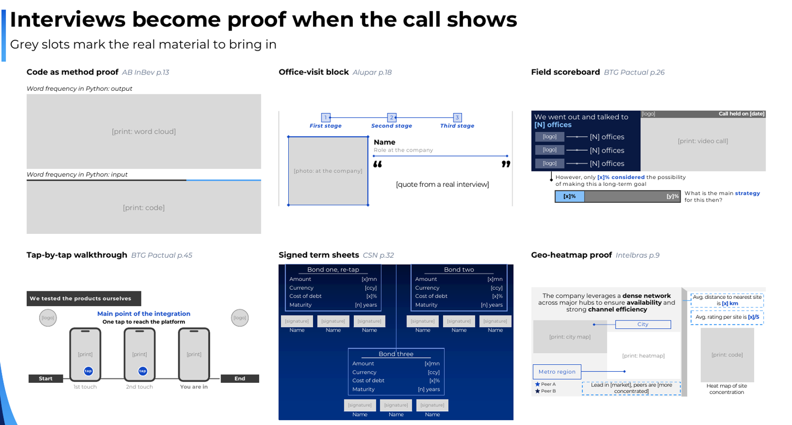

## Instalação

### Jeito rápido

Abra o Claude Code (app desktop, aba **Code**, ou `claude` no terminal), cole o prompt e mande. O Claude faz a instalação e te diz o que faltar.

```text
Quero usar o plugin slide-studio (https://github.com/ArthurMalucelli/slide-studio) para montar slides de
equity research. Faça a instalação completa por mim, rodando os comandos você mesmo:

1. Instale o plugin com o CLI:
   claude plugin marketplace add ArthurMalucelli/slide-studio
   claude plugin install slide-studio@slide-studio
2. Confira o Python 3 e instale as bibliotecas: pip install python-pptx lxml pillow
   (se o pip reclamar de ambiente gerenciado, use --user ou um venv, e me diga qual usou).
3. Confira se o pdftoppm (Poppler) existe. Se não existir, instale: no Mac `brew install poppler`; no Windows
   `choco install poppler` ou `winget install oschwartz10612.Poppler`. Se precisar de senha de administrador, me
   passe o comando para eu rodar.
4. Confira se o Microsoft PowerPoint está instalado. Se não estiver, me avise que a validação vai usar o
   LibreOffice e pode sair diferente.
5. No fim, me mostre uma tabela com o que ficou OK e o que falta eu fazer. Diga também que preciso abrir uma
   sessão nova do Claude Code para as skills aparecerem.

Depois, me explique em 5 linhas como usar /ppt-researcher e /ppt-designer.
```

### Manual

1. **Plugin**, no Claude Code:
   ```
   /plugin marketplace add ArthurMalucelli/slide-studio
   /plugin install slide-studio@slide-studio
   ```
2. **Python 3** com as bibliotecas:
   ```bash
   pip install python-pptx lxml pillow
   ```
3. **Poppler** (`pdftoppm`, para o Claude ver o slide):
   - Mac: `brew install poppler`
   - Windows: `choco install poppler` ou [poppler-windows](https://github.com/oschwartz10612/poppler-windows)
4. **Microsoft PowerPoint**, para validar. Sem ele, o designer usa o LibreOffice e avisa que gráficos podem sair diferentes.
5. **A fonte do seu mestre instalada** (ex.: Montserrat, no Google Fonts). Sem ela, o PDF troca a fonte.

### Atualizar

```bash
claude plugin marketplace update slide-studio && claude plugin update slide-studio@slide-studio
```

Depois, reinicie o Claude Code. As novidades de cada versão estão no [CHANGELOG](CHANGELOG.md).

## Uso

**1. Pesquise e gere o roteiro**

```text
/ppt-researcher Embraer "riscos"
```

Responda se o slide é **expositivo** ou **analítico**, qual o ângulo, se houver, e quantas rodadas o crítico pode rodar. Sem resposta, não há limite. O roteiro sai em `research/Embraer-riscos/roteiro.md`, com a mensagem principal, os blocos, as fontes e o material real disponível.

**2. Monte o slide**

```text
/ppt-designer ~/Desktop/MeuMestre.pptx research/Embraer-riscos/roteiro.md
```

Na primeira vez do deck, responda as preferências, que ficam em `deck_prefs.json`:

| Preferência | Opções | Padrão |
|---|---|---|
| Fundo | branco, do mestre, escuro | branco |
| Barras e blocos de dados | planos, 3D isométrico | planos |
| Uso do 3D | só ilustração, também dados, nunca | só ilustração |
| Números grandes | não, sim | não |
| Nível visual | rico, sóbrio | rico |

No modo **rico**, todo slide de conteúdo leva uma peça de profundidade discreta: uma cunha quando um número abre em outro, ou uma dobra entre dois painéis ligados.

**3. Ajuste em português normal**

```text
ajusta: deixa o mapa da esquerda na largura inteira
```

O designer gera a versão seguinte com o mesmo roteiro, sem pesquisar de novo. Se o Claude não reconhecer `/ppt-researcher`, use o prefixo: `/slide-studio:ppt-researcher`.

## Regras de design

Vieram de decks reais e de revisões de quem apresentou. Estão em [`RULES.md`](skills/ppt-designer/references/RULES.md):

- Nenhum número ou período em título e cabeçalho de painel.
- Um cabeçalho e um itálico por visual, sem terceiro nível de texto.
- Sem bloco de notas na face do slide: as ressalvas vão para as notas do apresentador.
- Sem colunas de texto coladas no gráfico.
- Nunca gráfico de barras com só duas barras, nem linha com marcador nos pontos.
- No máximo 3 gráficos por slide, e sem linhas divisórias finas.
- Nada aparece do nada: a peça de profundidade fica presa ao conteúdo e é discreta.
- Uma peça por slide: nem peça forte solta, nem slide totalmente plano.
- Até ~130 palavras e 50 dados por slide.
- Rodapé sempre `Sources: Company Data, Group Calculations.`
- Data label em um único estilo.
- Cor com significado fixo e um único destaque por painel.
- Números exatamente como no roteiro.
- Validação no PDF exportado pelo PowerPoint.

## Estrutura

```text
skills/
├── ppt-researcher/          pesquisador, crítico de vãos, modelo de roteiro
└── ppt-designer/
    ├── SKILL.md             fluxo do designer
    ├── lib/                 biblioteca de componentes, leitor de mestre, dados de mapa
    ├── scripts/             exportação pelo PowerPoint (Mac e Windows)
    └── references/
        ├── RECEITA.md       como montar um bom slide
        ├── RULES.md         regras de design
        ├── aprovados/       peças aprovadas, com dados fictícios
        ├── reprovados/      erros reprovados, com dados fictícios
        ├── COMPONENTS.md    o que a biblioteca desenha
        ├── PITFALLS.md      bugs do PowerPoint já resolvidos
        ├── catalogo/        590 técnicas: origem, recorte e receita
        ├── pecas_*.py       peças prontas para copiar
        └── exemplos/        987 slides por propósito e por visual, com prints e PDFs
```

Para ver as peças no seu mestre, sem o Claude:

```bash
python3 skills/ppt-designer/references/pecas_mapas_a.py MeuMestre.pptx teste.pptx 0
```

Troque `pecas_mapas_a` por `pecas_mapas_b`, `pecas_profundidade`, `pecas_diagramas`, `pecas_elementos`, `pecas_elementos_a`, `pecas_elementos_b` ou `pecas_moldes`. O último número é o índice do layout do mestre.

## Limitações

- **Fluxos e diagramas:** ainda sem versão aprovada. Para conteúdo qualitativo, o designer aciona um agente de criatividade, que propõe 3 representações.
- **Imagens geradas:** `gerar_imagem.py` depende do Codex CLI; sem ele, entrega o prompt para você gerar onde quiser. A marca nos mockups ainda não foi validada.
- **Paletas do Color Hunt:** o site não tem API pública, então a busca pode parar de funcionar. Nesse caso, passe os códigos com `--hex`.
- **Mapas:** há estados de RUS, USA, IND, IDN, CHN, BRA, CAN, AUS e ZAF. Não há municípios: as malhas municipais das peças são fictícias e não podem representar dado real. Malha de rua e terreno ficam como molde.
- **Tamanho das peças:** muitas foram testadas em caixa pequena. Em caixa maior, ajuste as fontes para os tamanhos das regras.
- **Peças mais fracas:** a lista está em [`catalogo/INDEX.md`](skills/ppt-designer/references/catalogo/INDEX.md).
- **PowerPoint:** a validação completa pede o Microsoft PowerPoint. O LibreOffice pode renderizar gráficos de outro jeito.

## Aviso sobre o catálogo

Os PDFs, as prints e os recortes em `references/` vêm de decks de equipes de competições de equity research e entram **só como referência de design**. Eles pertencem aos seus autores. Use o catálogo para aprender o layout; não copie conteúdo, marca ou dados.
